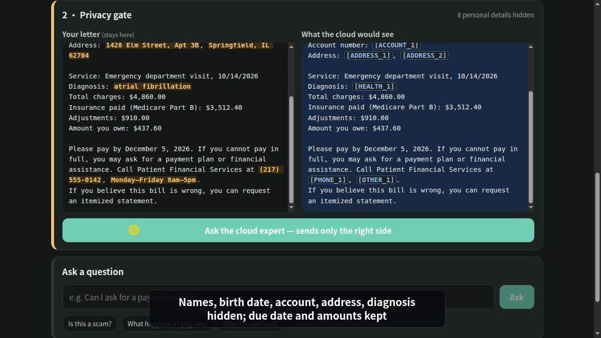
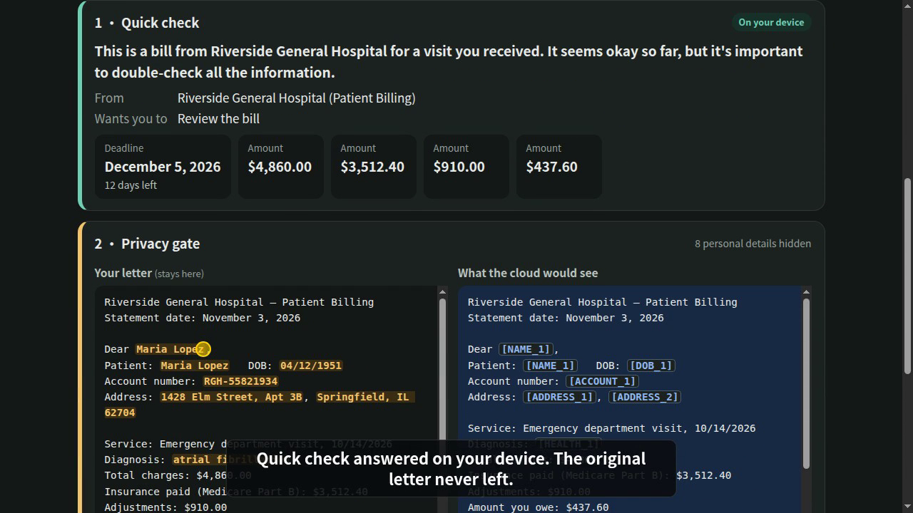
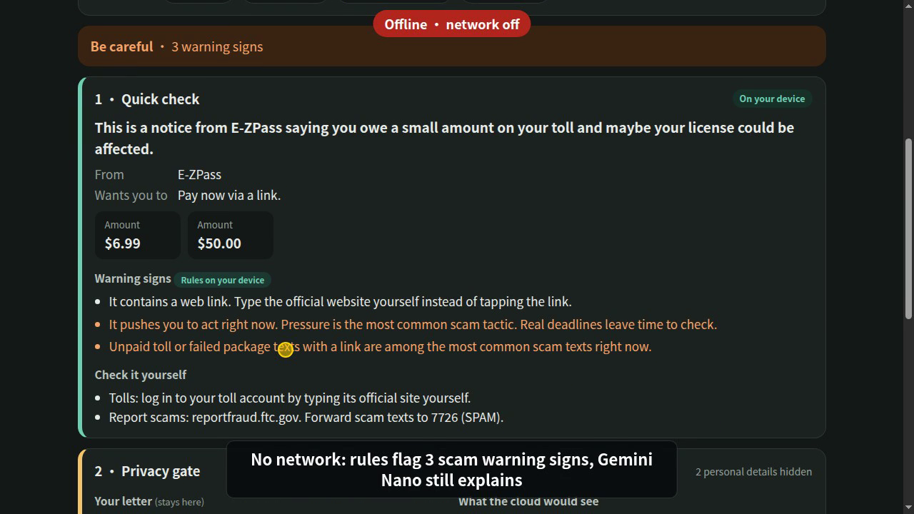

# Plain Letter

**Understand any confusing letter, bill or text message, without your personal details leaving your computer.**

Older adults and people new to the US get letters they cannot decode: hospital bills, Medicare notices, insurance explanations, tax letters, and scam texts dressed up to look like them. The usual advice is "paste it into an AI chatbot". But those letters are full of exactly what you should never paste anywhere: names, dates of birth, account and member numbers, home addresses, diagnoses.

Plain Letter uses **Firebase AI Logic hybrid inference** as a privacy gate:

| | Runs where | Sees |
|---|---|---|
| Find personal details the rules missed | **On device only** (`ONLY_ON_DEVICE`, Gemini Nano in Chrome) | the original letter |
| Quick check: what is it, should I worry | **On device only** when a local model exists | the original letter |
| Quick check without a local model | **Prefer on device**, falls back to cloud | the *redacted* letter |
| Expert explanation, next steps, questions to ask | **Prefer in cloud** (Gemini), offline falls back to device | the *redacted* letter |
| Follow-up questions | **Prefer on device**, falls back to cloud | the *redacted* letter + redacted question |
| Put names back into the answer | Your device, no model | — |

One rule decides every request: **original text never leaves the device; only redacted text may.**

**Try it:** https://onlyaguest.github.io/plain-letter/ (desktop Chrome; no sign-up) · **Demo video (2:55):** see the Devpost page



| Quick check by Gemini Nano, on the device | Network off: still works on the device |
|---|---|
|  |  |

## What it does
1. **Paste a letter or upload a photo.** Text recognition runs in the browser (tesseract.js); the image is never uploaded.
2. **Rules on the device**, no AI: dates and deadlines, dollar amounts, 11 common scam warning signs (gift cards, "warrant for your arrest", toll texts, codes, remote access…). A risk raised by the rules can never be lowered by a model.
3. **Privacy gate.** Rule-based redaction (names after salutations and labels, SSNs, card numbers with Luhn check, account / member / claim numbers, dates of birth, street addresses, private phone numbers, emails, diagnoses, link paths) plus the on-device model for anything the rules miss. Each value becomes a stable placeholder like `[NAME_1]`. The screen shows the letter and **exactly what the cloud would see**, side by side.
4. **Leak check before every cloud call.** If any original value or any detectable personal pattern is still in the payload, the request is blocked.
5. **Cloud expert** explains the redacted letter in plain English: summary, steps, money, questions to ask, what is unclear, what can be ignored.
6. **Back on the device**, placeholders become the real names again, and any amount or date the model mentions that is not in the letter is flagged.
7. **"What left my computer"** lists every cloud request exactly as sent. Every answer carries a badge: *On your device* or *Cloud · saw redacted text only* (from `response.inferenceSource`).

## Run it
Node.js 20+.

```bash
npm install
cp .env.example .env.local   # fill in your Firebase web app config + reCAPTCHA Enterprise key
npm run dev
npm test                     # unit tests for redaction, scam rules, facts and the router
npm run build                # static site in dist/
```

Without Firebase config the app starts in a clearly labelled **demo mode**: rules, redaction, the gate and the ledger are real; AI answers are pre-written for the four samples.

**On-device model:** Chrome with the built-in Prompt API (Gemini Nano). The badge in the header shows whether it is ready, downloadable (click *Download*) or not available on this computer.

## Firebase setup
1. Create a Firebase project, add a Web app, and enable **Firebase AI Logic** with the Gemini Developer API (free tier).
2. Enable **App Check** with reCAPTCHA Enterprise for your domain (required by Firebase AI Logic); for local development set `VITE_APPCHECK_DEBUG=true` and register the printed debug token.
3. Put the config into `.env.local`.

## Testing it (for judges)
- Open the live demo in **desktop Chrome** and click a sample (*Hospital bill*, *Unpaid toll text*, *"IRS" phone message*, *Medicare notice*). No account needed.
- **Expected result on a typical Chrome** (no local model): a risk banner and rule-based warning signs at once, a quick check in a few seconds marked *Cloud · saw redacted text only*, and the privacy gate with your letter next to the redacted text. Downloading the local model is optional.
- **Without Chrome's built-in model** (the header says *can be downloaded*): the quick check uses `PREFER_ON_DEVICE` and falls back to Gemini in the cloud, on the redacted text only. The badge on each answer says where it ran.
- **With Chrome's built-in model** (header: *On-device AI ready*; or click *Download*, about 4 GB, needs Chrome's [hardware requirements](https://developer.chrome.com/docs/ai/get-started)): finding personal details and the quick check run on the device; *Ask the cloud expert* sends only the right-hand side.
- With the local model ready, turn the network off after the page has loaded: rules and Gemini Nano still answer.
- *What left my computer* shows every cloud request exactly as sent.
- Cloud calls are protected by App Check (reCAPTCHA Enterprise). Automated or headless browsers may fail App Check; then the AI steps say *not available* and the on-device rules still run.

## Built during the hackathon
The repository was created on Nov 17, 2026, inside the Submission Period. Everything here was built for this hackathon: the privacy gate (rule redaction, on-device model redaction, leak check, restore), the Firebase AI Logic routing with one model per task, App Check, the English UI and samples, the tests and the demo. It adapts a few ideas from my earlier Chinese-language scam-text explainer (warning-sign rules, photo text recognition, checking the model's numbers against the letter). Code was written with an AI coding assistant (Claude Code), which the rules allow.

## Code map
- `src/lib/pipeline.js`: the privacy-aware router (where each prompt runs) and the leak check flow
- `src/lib/ai.js`: Firebase AI Logic models, one per task, each with an explicit inference mode
- `src/lib/redact.js`: rule redaction, restore, leak check
- `src/lib/redflags.js`: scam warning signs and official places to check
- `src/lib/facts.js`: dates, deadlines, money, and the fact gate for model answers
- `src/lib/prompts.js`: prompts and JSON schemas (shared by device and cloud)

## Open-source libraries
React (MIT), Vite (MIT), Firebase JS SDK (Apache-2.0), tesseract.js (Apache-2.0) with the English tessdata model (Apache-2.0).

## Limits
Plain Letter explains; it does not give legal, medical or financial advice. Redaction rules are tuned for US letters in English; the on-device model is the second line, not a guarantee. When in doubt, call the official number you find yourself.

## License
Apache-2.0
